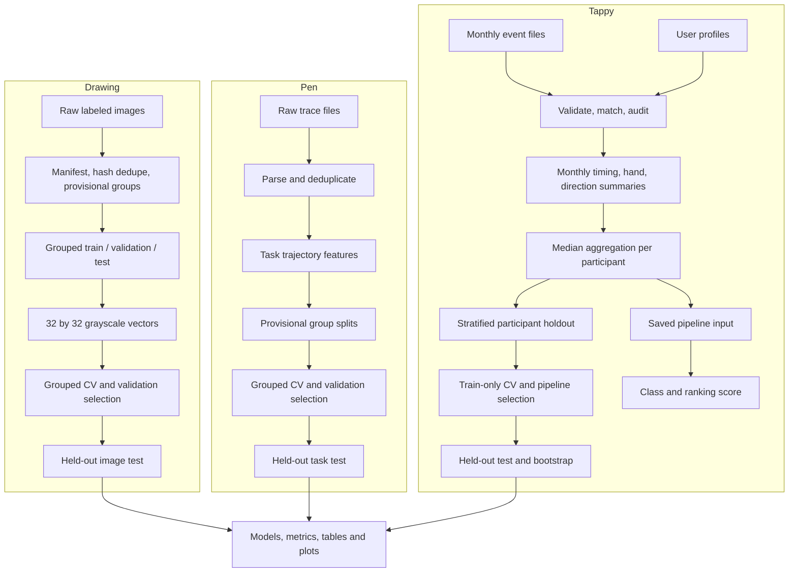

# Architecture and data flow

Each dataset has a separate pipeline. Images become grayscale pixel vectors, pen traces become task-level features, and Tappy event logs become monthly summaries then one participant row. Each trainer owns splitting, model selection, evaluation and artifact writing.

For Tappy, monthly records are aggregated before the participant split. Imputation and scaling are inside sklearn pipelines and learned within training folds. Drawing and pen groups are filename-derived provisional tokens; source-level identity verification is still needed. The saved estimators are independent: no shared feature space or verified cross-dataset participant key exists for fusion.
