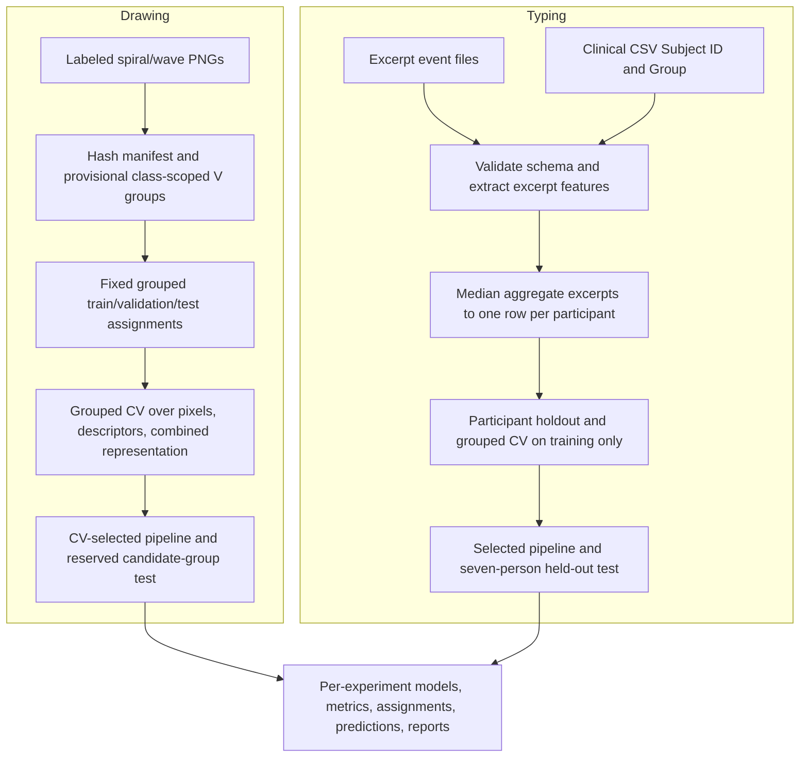

# Active pipeline architecture

The repository contains independent drawing and virtual-touchscreen-typing experiments. No shared participant crosswalk or harmonized feature space supports fusion.

Drawing image transforms are deterministic and independent per image; scaling and estimators are inside sklearn cross-validation pipelines. `V##` tokens are unverified candidate groups, so even group-disjoint evaluation does not prove participant independence. The typing loader links event folders and excerpt names to the clinical `Subject ID`; excerpts are aggregated before participant-level splitting. Typing imputation, missingness indicators and scaling are fitted inside each training fold.

The legacy handwriting and Tappy source trainers were removed from active source. Their existing model/result artifacts and local raw datasets are retained unchanged as historical material.
